 <div align="center">


# FedEx Logistics Operations Analysis

### Exploratory Data Analysis · Logistics & Supply Chain Analytics

**Transforming Shipment Data into Operational Insights**

[](https://www.python.org/)
[](https://pandas.pydata.org/)
[](https://colab.research.google.com/)
[](https://seaborn.pydata.org/)

</div>

---

## 📌 Executive Summary

The **FedEx Logistics Operations Analysis** project explores shipment and supply chain data to understand transportation patterns, shipment weights, freight costs, destination distribution, vendor activity, manufacturing sites, and data quality.

Using Python-based exploratory data analysis (EDA), the project applies data inspection, cleaning, descriptive statistics, correlation analysis, and data visualization to examine logistics operations and identify areas that may warrant further investigation.

The project was developed in **Google Colab** using Pandas, NumPy, Matplotlib, Seaborn, and Plotly.

## 🎯 Project Objectives

- Analyze shipment distribution across transportation modes and destination countries.
- Examine vendor and manufacturing-site shipment activity.
- Investigate freight-cost and shipment-weight distributions.
- Explore relationships between shipment weight and freight cost.
- Compare freight costs across shipment modes and destinations.
- Evaluate numerical variables using descriptive statistics and correlation analysis.
- Identify missing values and data-quality considerations.
- Communicate findings through clear, professional visualizations.

## 🧰 Technology Stack

| Technology | Purpose |
|---|---|
| Python | Core programming and analysis |
| Pandas | Data manipulation and cleaning |
| NumPy | Numerical operations |
| Matplotlib | Statistical and exploratory charts |
| Seaborn | Statistical visualization |
| Plotly | Interactive visualization |
| Google Colab | Notebook development and execution |

---

## 📊 Visualization Gallery

The following gallery contains the project's visual outputs. Each image is linked directly from the repository's `preview/` folder.

### 1. Shipment Network & Operational Distribution

#### 01. Top 10 Destination Countries by Shipments

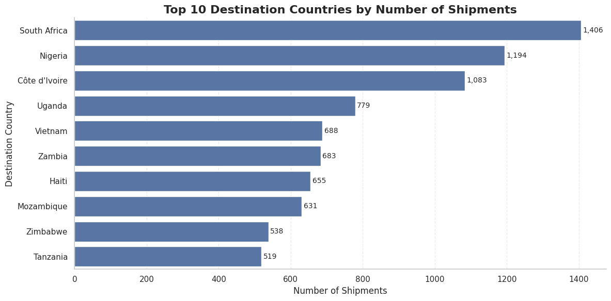

#### 02. Shipment Distribution by Mode

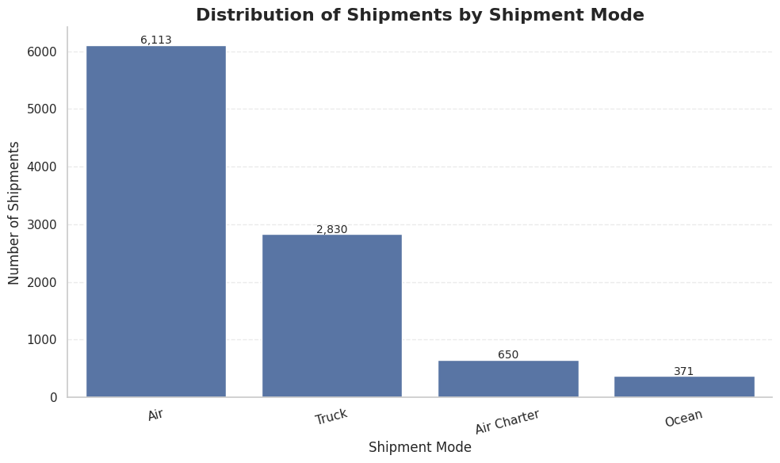

#### 03. Top 10 Vendors by Shipments

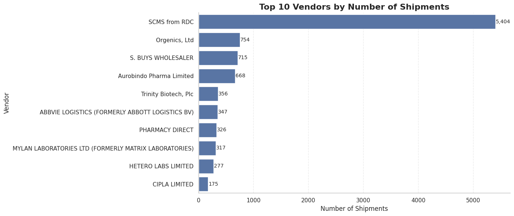

#### 04. Top 10 Manufacturing Sites by Shipments

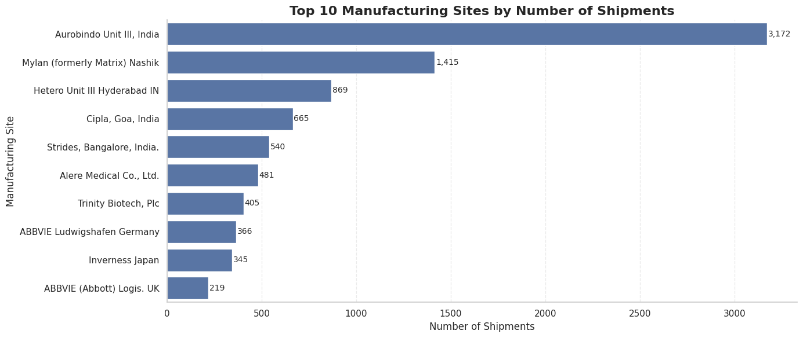

#### 09. Top 10 Destination Countries by Average Freight Cost

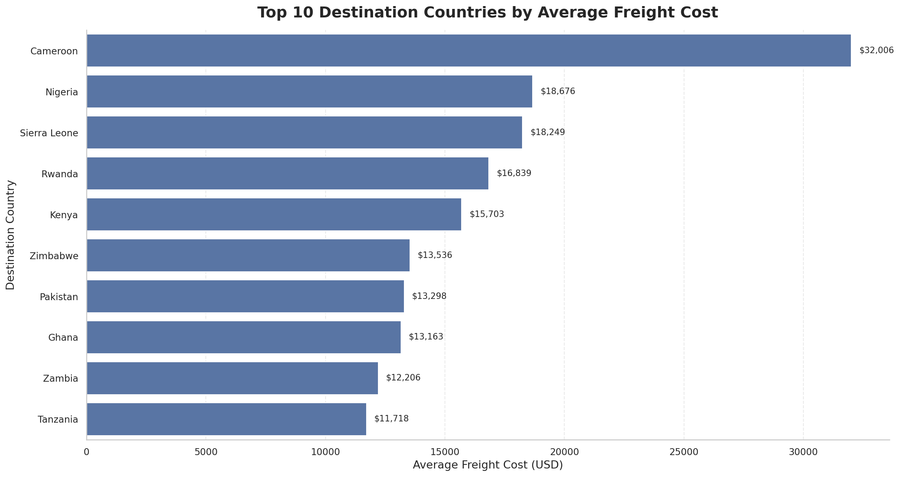

#### 10. Top 15 Destination Countries by Shipment Count

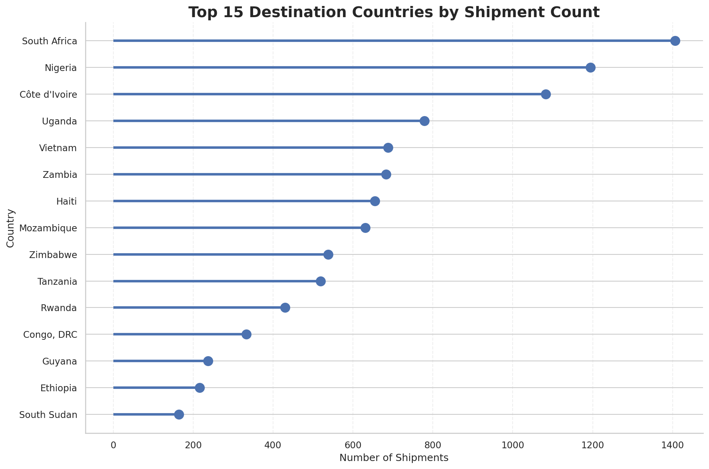

---

### 2. Freight Cost & Shipment Weight Analysis

#### 05. Freight Cost Distribution (USD)

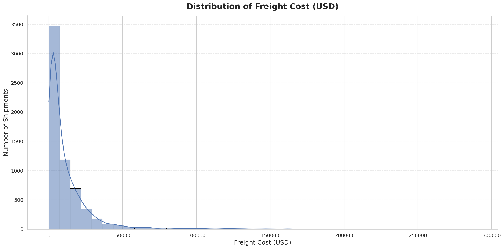

#### 06. Shipment Weight Distribution (kg)

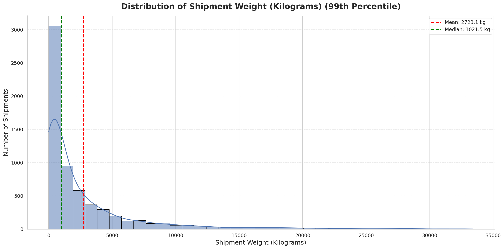

#### 07. Freight Cost by Shipment Mode

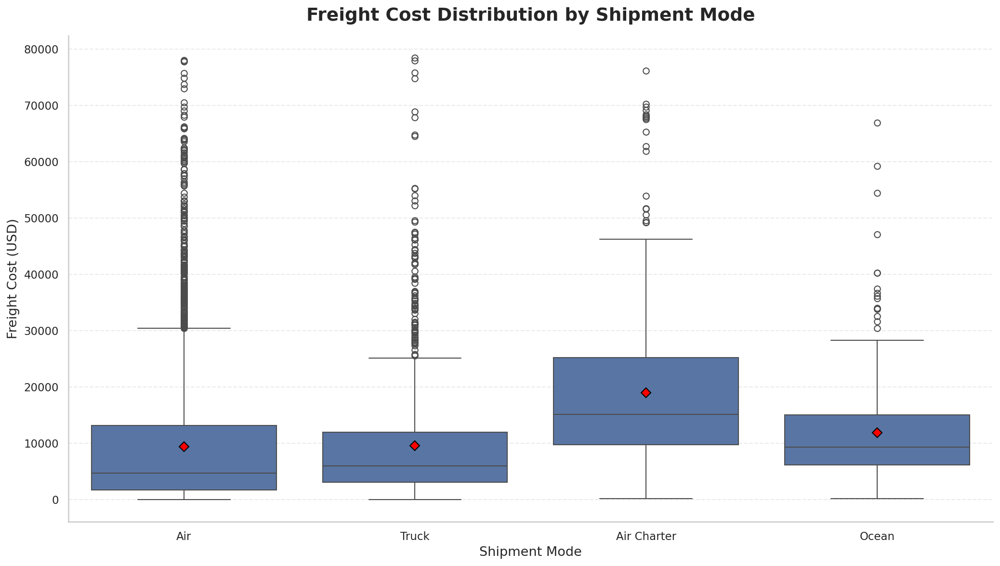

#### 08. Shipment Weight vs Freight Cost

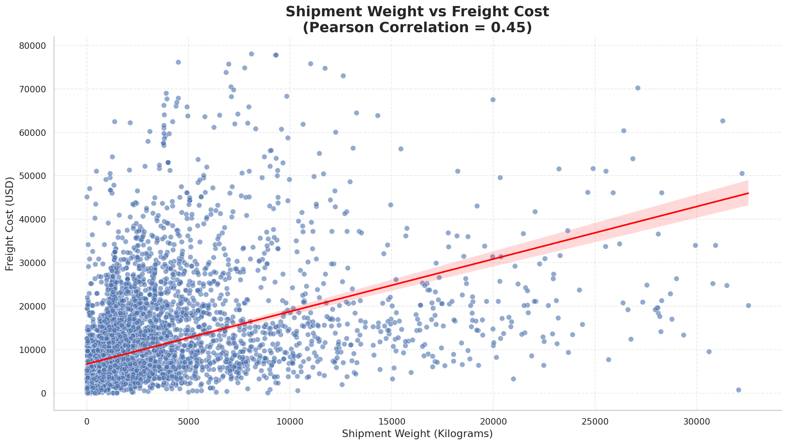

#### 11. Shipment Weight Distribution by Mode

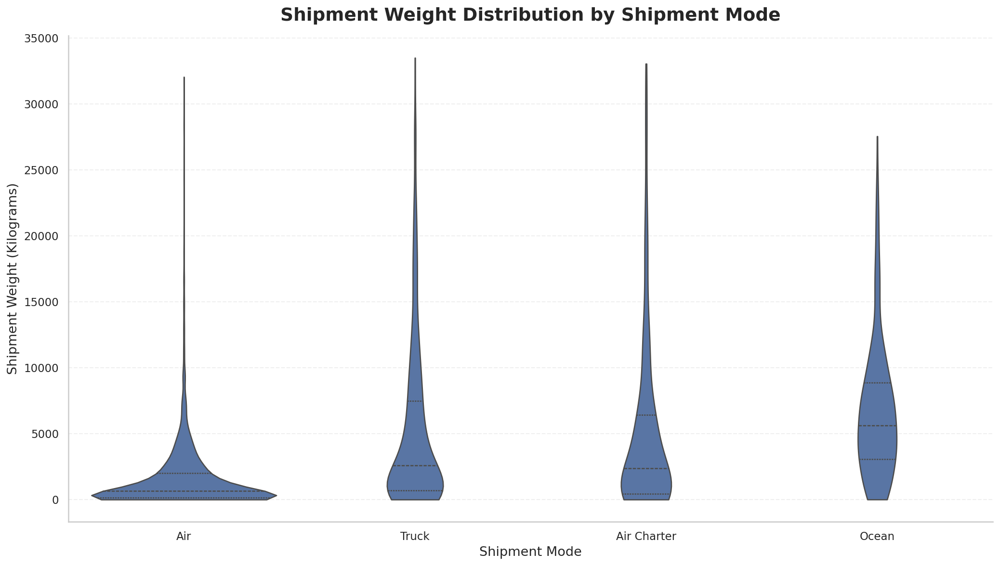

#### 12. Shipment Weight vs Freight Cost Analysis

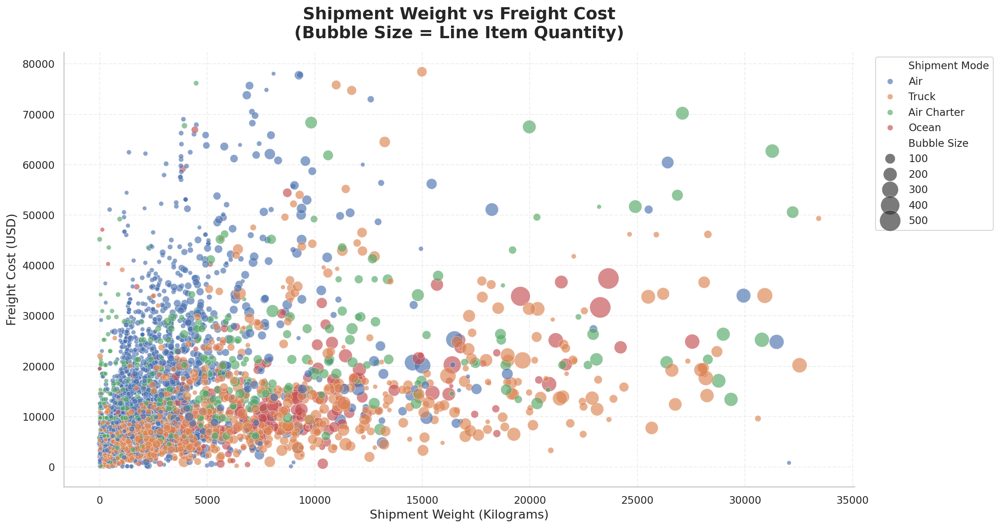

---

### 3. Statistical Analysis & Data Quality

#### 13. Shipment Mode Distribution

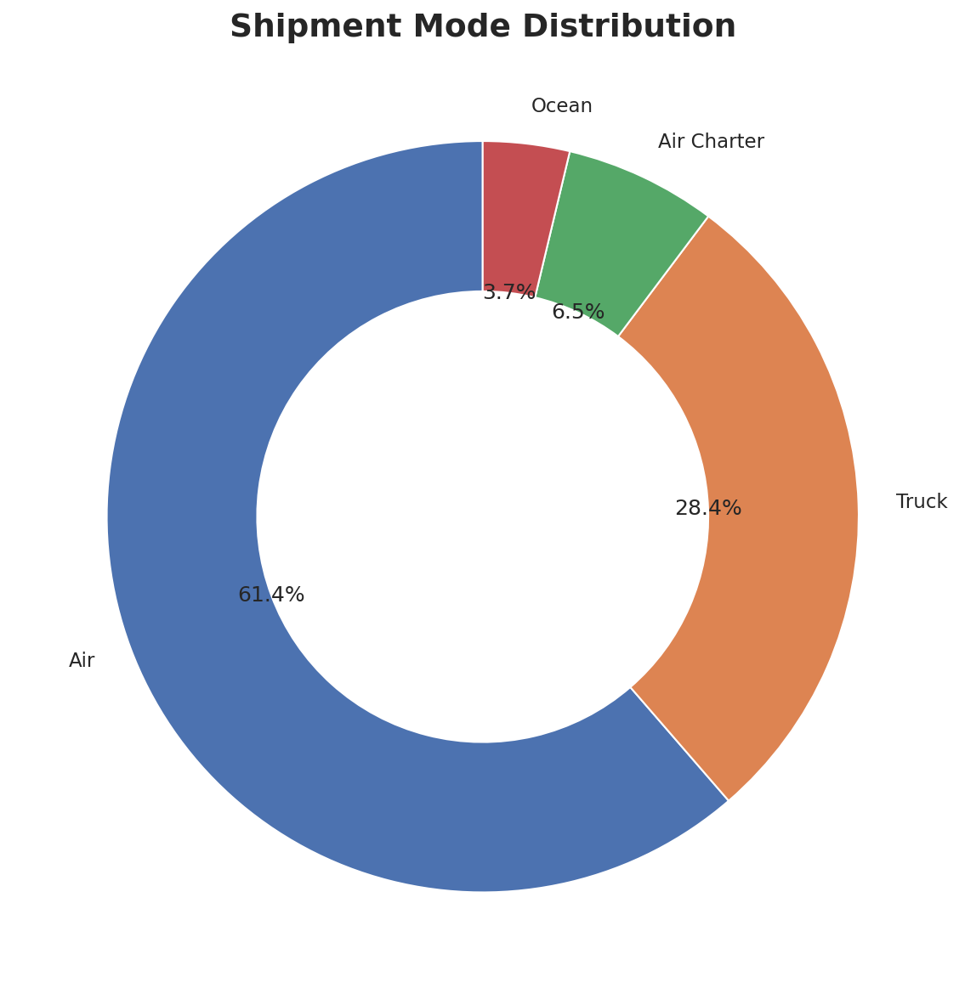

#### 14. Correlation Heatmap — Logistics Variables

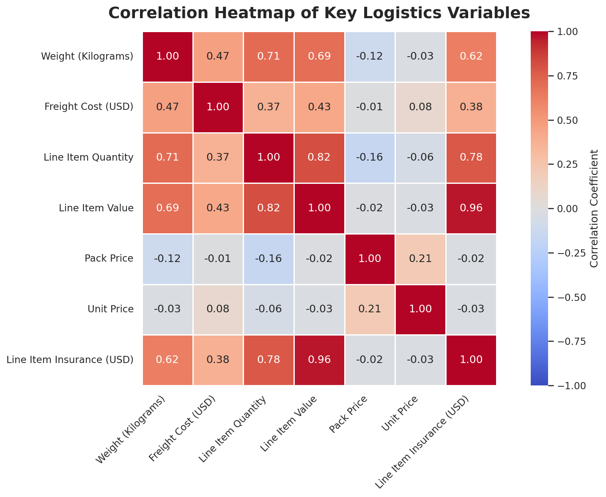

#### 15. Pair Plot — Logistics Variables

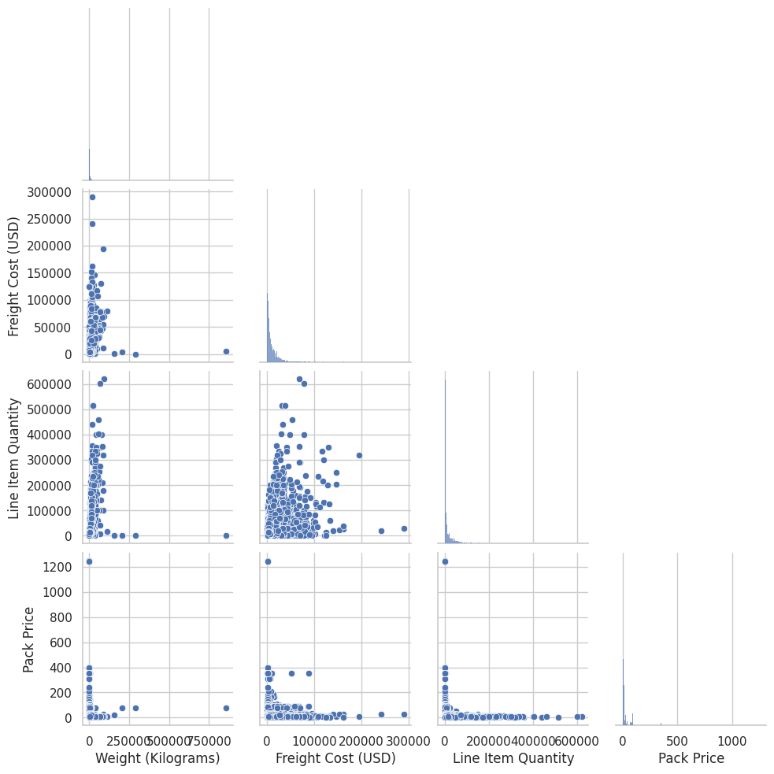

#### 16. Missing Values by Feature

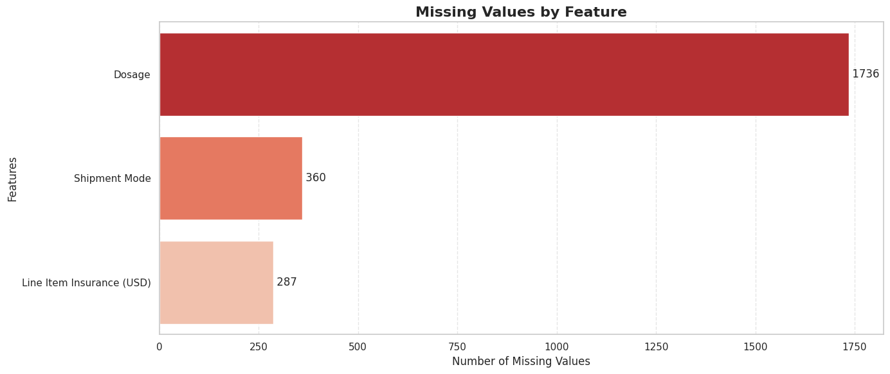

#### 17. Statistical Summary — Numerical Features

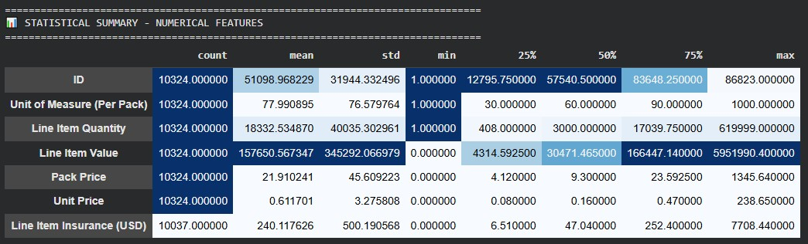

---

## 🔍 Analytical Methodology

The project follows a structured exploratory analysis workflow:

| Stage | Activities |
|---|---|
| 1. Data Understanding | Inspect dataset dimensions, columns, data types, and sample records |
| 2. Data Quality | Examine missing values, duplicates, and potential inconsistencies |
| 3. Data Preparation | Prepare relevant fields for analysis and visualization |
| 4. Descriptive Analysis | Summarize numerical variables and shipment distributions |
| 5. Univariate Analysis | Explore freight costs, shipment weights, and categorical distributions |
| 6. Comparative Analysis | Compare costs and shipment weights across available operational categories |
| 7. Relationship Analysis | Examine correlations and weight–freight cost patterns |
| 8. Visualization | Present findings through Matplotlib, Seaborn, and Plotly |
| 9. Interpretation | Identify patterns and questions for further operational investigation |

## 💡 Business Questions Explored

- Which destination countries account for the largest shipment counts?
- How are shipments distributed across transportation modes?
- Which vendors and manufacturing sites have the highest shipment activity?
- How are freight costs and shipment weights distributed?
- How do freight costs vary across shipment modes and destination countries?
- Is shipment weight associated with freight cost?
- Which numerical variables show relationships in the correlation analysis?
- Which features have missing values that may affect interpretation?

## 📈 Potential Business Applications

The analytical approach can support further investigation into:

- **Transportation planning:** Compare shipment patterns across available modes.
- **Freight-cost monitoring:** Identify cost distributions and categories for additional review.
- **Destination analysis:** Understand shipment concentration across countries.
- **Vendor and site analysis:** Review shipment activity by vendor and manufacturing location.
- **Data governance:** Prioritize missing-value assessment and data-quality improvements.
- **Operational research:** Develop additional analyses using transit times, service levels, delivery outcomes, and other validated fields if available.

*These are potential applications of the analysis, not claims of measured cost savings or operational improvements.*

## 🗂️ Repository Structure

```text
Fed-ex/
│
├── README.md
├── Sample_EDA_Submission_Template.ipynb
├── requirements.txt
│
└── preview/
    ├── Fed-ex-logo.png
    ├── 01-top-10-destination-countries-by-shipments.png
    ├── 02-shipment-distribution-by-mode.png
    ├── 03-top-10-vendors-by-shipments.png
    ├── 04-top-10-manufacturing-sites-by-shipments.png
    ├── 05-freight-cost-distribution-usd.png
    ├── 06-shipment-weight-distribution-kg.png
    ├── 07-freight-cost-by-shipment-mode.png
    ├── 08-shipment-weight-vs-freight-cost.png
    ├── 09-top-10-destination-countries-by-average-freight-cost.png
    ├── 10-top-15-destination-countries-by-shipment-count.png
    ├── 11-shipment-weight-distribution-by-mode.png
    ├── 12-shipment-weight-vs-freight-cost-analysis.png
    ├── 13-shipment-mode-distribution.png
    ├── 14-correlation-heatmap-logistics-variables.png
    ├── 15-pair-plot-logistics-variables.png
    ├── 16-missing-values-by-feature.png
    └── 17-statistical-summary-numerical-features.png
```

## 🚀 How to Run the Project

### Option 1: Google Colab

1. Open `Sample_EDA_Submission_Template.ipynb` in the repository.
2. Select **Open in Colab** if the notebook is available through the GitHub–Colab integration.
3. Upload or connect the dataset required by the notebook.
4. Run the cells sequentially.
5. Review the generated charts, statistical summaries, and findings.

### Option 2: Run Locally

**1. Clone the repository**

```bash
git clone <YOUR-GITHUB-REPOSITORY-URL>
cd Fed-ex
```

**2. Create a virtual environment**

```bash
python -m venv .venv
```

Activate it on Windows:

```bash
.venv\Scripts\activate
```

**3. Install dependencies**

```bash
pip install -r requirements.txt
```

**4. Launch Jupyter Notebook**

```bash
jupyter notebook
```

Open `Sample_EDA_Submission_Template.ipynb` and execute the cells. Make sure the dataset is available at the path expected by the notebook.

### Requirements

If you do not already have a `requirements.txt` file, create one containing:

```text
pandas
numpy
matplotlib
seaborn
plotly
jupyter
```

## ⚠️ Limitations & Future Scope

- The reliability of findings depends on the completeness and accuracy of the available dataset.
- Correlation does not establish causation.
- Observed differences in freight costs may reflect factors not captured in the analyzed variables.
- Missing values and inconsistent records should be assessed before drawing operational conclusions.
- Future work could include delivery-time analysis, carrier performance benchmarking, cost prediction, anomaly detection, and an interactive dashboard, subject to the availability of suitable data.

## 👤 Project Details

| Field | Details |
|---|---|
| Project | FedEx Logistics Operations Analysis |
| Project Type | Individual Project |
| Domain | Logistics & Supply Chain Analytics |
| Analysis Type | Exploratory Data Analysis (EDA) |
| Environment | Google Colab |
| Author | Ayush Dash |

## 📚 References

- [Python Documentation](https://docs.python.org/3/)
- [Pandas Documentation](https://pandas.pydata.org/docs/)
- [NumPy Documentation](https://numpy.org/doc/)
- [Matplotlib Documentation](https://matplotlib.org/stable/)
- [Seaborn Documentation](https://seaborn.pydata.org/)
- [Plotly Python Documentation](https://plotly.com/python/)
- [Google Colab](https://colab.research.google.com/)

---

<div align="center">

**FedEx Logistics Operations Analysis**

*Exploring logistics data. Understanding operational patterns. Supporting data-driven decisions.*

</div>
